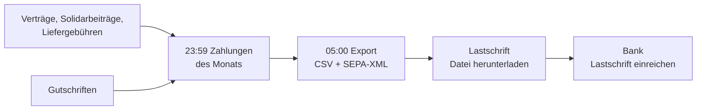
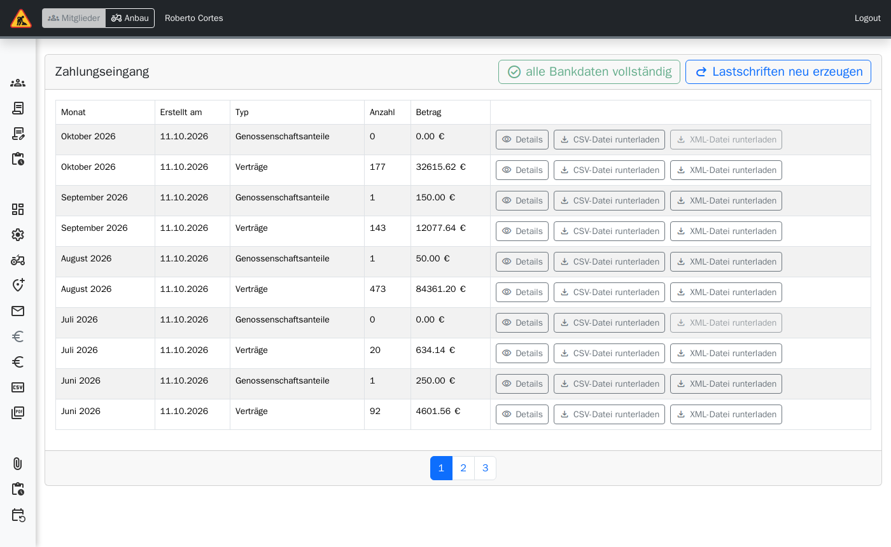
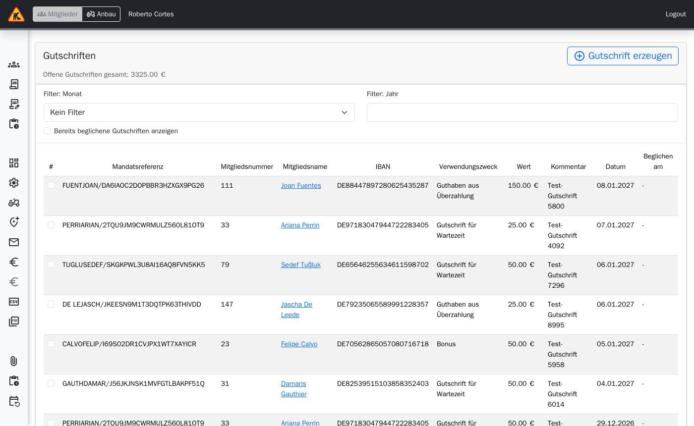

# Verwaltung: Zahlungen

> **Kurz gesagt:** Tapir erzeugt jeden Abend die Zahlungen und jeden Morgen um 5 Uhr die
> Lastschrift-Dateien (CSV und SEPA-XML) für die Bank. Unter **Lastschrift** laden Sie sie
> herunter. Gutschriften – etwa für Joker – entstehen automatisch oder von Hand unter
> **Gutschriften** und werden als beglichen markiert, wenn sie ausgezahlt bzw. verrechnet sind.

## Ablauf

## Lastschrift

**Administration → Lastschrift**, Karte „Zahlungseingang“:

- Tabelle je Export: Monat, erstellt am, Typ (Verträge oder Genossenschaftsanteile), Anzahl,
  Betrag.
- **Details** zeigt je Mitglied Mandatsreferenz, Verwendungszweck und Summe.
- **CSV-Datei runterladen**, **XML-Datei runterladen** (SEPA pain.008 für die Bank).
- Knopf „n Benutzer:in mit unvollständigen Bankdaten“ führt zu den Mitgliedern, denen IBAN oder
  Mandat fehlt.
- **Lastschriften neu erzeugen**: nur für den laufenden Monat und nur, wenn etwas falsch war –
  nicht umkehrbar, die alten Dateien gehen verloren.

## Gutschriften

**Administration → Gutschriften**:

- **Gutschrift erzeugen**: Fälligkeitsdatum, Mitglied, Wert (€), Verwendungszweck, Kommentar.
- Filter: Monat, Jahr, „Bereits beglichene Gutschriften anzeigen“.
- Auswahl anhaken → **n als beglichen markieren**.
- Joker-Gutschriften entstehen automatisch um 6 Uhr.

## Gut zu wissen

- Fälligkeitstag, Zahlungsintervalle, Gläubiger-ID, Mandatsreferenz-Muster und
  Verwendungszwecke stellen Sie in der [Konfiguration](Handbuch-Verwaltung-Konfiguration),
  Kategorie Zahlungen, ein.
- In der Probezeit wird nachträglich abgebucht, danach im Voraus – im Übergangsmonat fallen zwei
  Beträge an. Das erklärt häufige Rückfragen.
