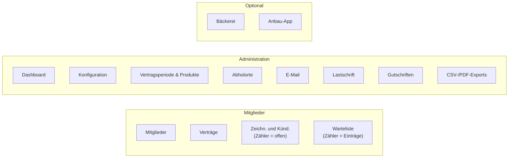
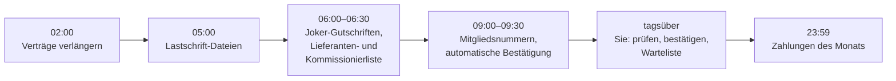
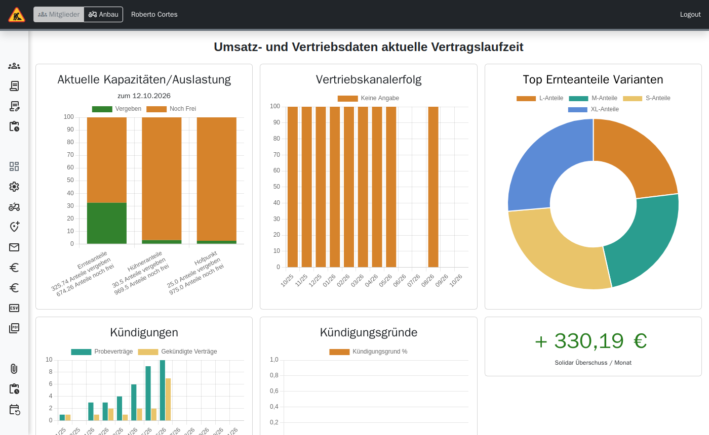

# Verwaltung: Überblick

> **Kurz gesagt:** Das Solawi-Team arbeitet in der App „Mitglieder“ mit dem Menü links:
> **Mitglieder** (Mitglieder, Verträge, Zeichnungen und Kündigungen, Warteliste) und
> **Administration** (Dashboard, Konfiguration, Produkte, Abholorte, E-Mail, Lastschrift,
> Gutschriften, Exporte). Vieles läuft automatisch: Nachts werden Verträge verlängert, morgens
> Lastschriften und Listen erzeugt, vormittags Bestellungen bestätigt. Ihre tägliche Aufgabe ist
> vor allem, neue Zeichnungen und Kündigungen zu prüfen und die Warteliste zu pflegen.

## Rollen

| Rolle | Darf |
|---|---|
| `coop.view` | Admin-Bereich und Dashboard sehen |
| `coop.manage` | Fast alle Änderungen: Verträge, Bestätigungen, Warteliste, Konfiguration, Exporte |
| `accounts.view` / `accounts.manage` | Mitgliederliste sehen / Mitglieder anlegen, Abholort, Zahlungsintervall, Historie |
| `payments.view` / `payments.manage` | Lastschriften und Gutschriften |
| `products.view` / `products.manage` | Vertragsperioden, Produkte, Preise |
| `email.manage` | E-Mail-Oberfläche |

Wer nur eine `view`-Rolle hat, sieht viele Seiten, kann dort aber nichts ändern. Rollen werden in
der Benutzerverwaltung (Keycloak) vergeben.

## Das Menü

## Der Tag in Tapir

## Dashboard

Unter **Administration → Dashboard**:

- Hinweise, falls keine aktive Vertragsperiode oder kein Basis-Produkt existiert.
- Umsatz und Vertrieb der laufenden Saison: Kapazität und Auslastung, Vertriebskanäle,
  beliebteste Varianten, Kündigungen mit Gründen, Solidar-Überschuss.
- Freiwerdende Kapazitäten je Verteilort und Kapazitäten der kommenden Saison.
- Cashflow-Vorschau und Daten der Genossenschaft (Mitglieder, Geschäftsguthaben, Anteile).

## Weiter

| Thema | Seite |
|---|---|
| Mitglieder suchen, anlegen, bearbeiten, Anteile | [Mitglieder](Handbuch-Verwaltung-Mitglieder) |
| Neue Verträge bestätigen, Sonderkündigung, Probezeit, Preis | [Verträge](Handbuch-Verwaltung-Vertraege) |
| Warteliste und Bestätigungslinks | [Warteliste](Handbuch-Verwaltung-Warteliste) |
| Saison, Produkte, Preise, Kapazitäten, Abholorte | [Produkte und Abholorte](Handbuch-Verwaltung-Produkte-und-Abholorte) |
| Lastschriften, Gutschriften | [Zahlungen](Handbuch-Verwaltung-Zahlungen) |
| Mails, Mailing-Listen, Exporte | [Kommunikation und Exporte](Handbuch-Verwaltung-Kommunikation-und-Exporte) |
| Einstellungen, Bäckerei, Debug | [Konfiguration](Handbuch-Verwaltung-Konfiguration) |
