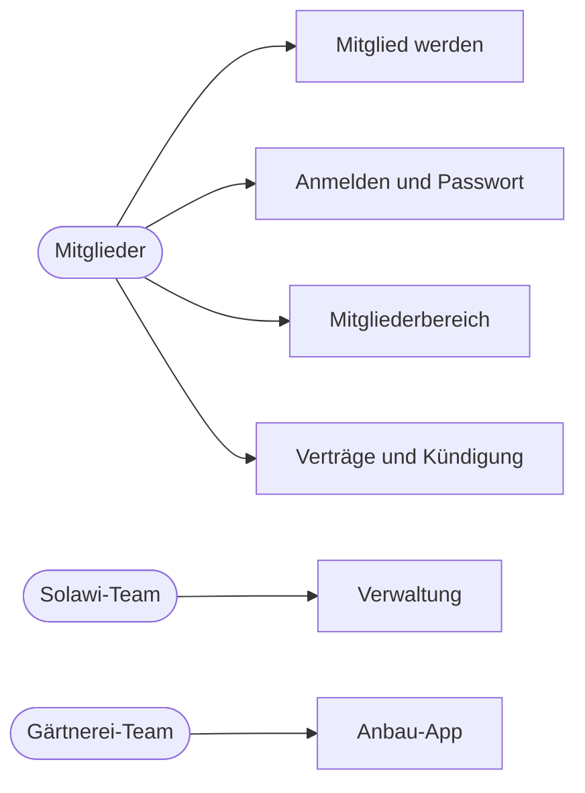

> ⚠️ **Nicht maßgeblich.** Dieses Wiki gehört zu einem abgeschlossenen Proof of Concept für den
> Eigenbetrieb von Tapir und wird nicht gepflegt. Maßgeblich ist die Dokumentation im
> Hauptprojekt: [FoodCoopX/wirgarten-tapir – docs](https://github.com/FoodCoopX/wirgarten-tapir/tree/master/docs),
> Aufbau in Issue [#1300](https://github.com/FoodCoopX/wirgarten-tapir/issues/1300).

# Handbuch

> **Kurz gesagt:** Das Handbuch erklärt Tapir für die Menschen, die damit arbeiten – ohne
> Technik. Mitglieder finden hier Anmeldung, Bestellung und ihren Mitgliederbereich, das
> Solawi-Team die Verwaltung, das Gärtnerei-Team die Anbau-App. Jede Seite beginnt mit einer
> Kurzfassung; Ablaufbilder zeigen, was nacheinander passiert.

## Für Mitglieder

- [Mitglied werden (Bestell-Wizard)](Handbuch-Mitglied-werden)
- [Anmelden und Passwort](Handbuch-Anmelden)
- [Mitgliederbereich](Handbuch-Mitgliederbereich)
- [Verträge und Kündigung](Handbuch-Vertraege)

## Für das Solawi-Team

- [Überblick](Handbuch-Verwaltung)
- [Mitglieder](Handbuch-Verwaltung-Mitglieder)
- [Verträge](Handbuch-Verwaltung-Vertraege)
- [Warteliste](Handbuch-Verwaltung-Warteliste)
- [Produkte und Abholorte](Handbuch-Verwaltung-Produkte-und-Abholorte)
- [Zahlungen](Handbuch-Verwaltung-Zahlungen)
- [Kommunikation und Exporte](Handbuch-Verwaltung-Kommunikation-und-Exporte)
- [Konfiguration](Handbuch-Verwaltung-Konfiguration)

## Für das Gärtnerei-Team

- [Anbau-App](Handbuch-Anbau)
- [Kulturen & Familien](Handbuch-Anbau-Stammdaten)
- [Anteilsinhalt & Bedarf](Handbuch-Anbau-Bedarf)

Hinweis: Jede Solawi stellt Texte, Fristen und Funktionen selbst ein. Beschrieben sind die
Standardwerte; bei Ihnen kann einiges anders heißen oder fehlen.

Die Bildschirmfotos stammen aus einer Testinstanz mit erfundenen Beispieldaten (Theme „Test“).
